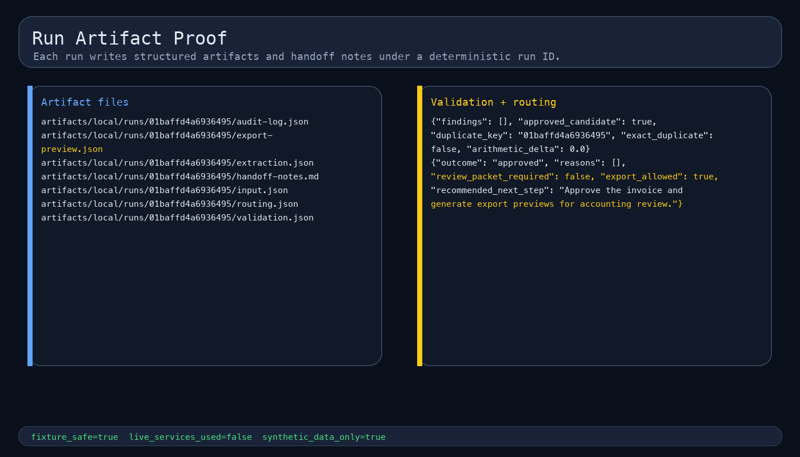

# Invoice Router

Validate invoice-shaped inputs, route uncertain cases to review and prepare accounting export previews.

**Status:** local reference implementation with synthetic invoices and deterministic extraction.

**My contribution:** invoice contracts, validation rules, review lifecycle, CLI/API interfaces and tests.

[Architecture](docs/architecture.md) · [Case study](docs/case-study.md) · [Walkthrough](docs/sandbox-walkthrough.md)



*Local synthetic example; the [image index](docs/screenshots/README.md) retains the full sequence.*

## How it works

1. Parse a synthetic invoice fixture into typed extracted fields.
2. Record confidence and source references for every required field.
3. Validate arithmetic, currency, dates, tax IDs, duplicates, and line items.
4. Approve clean high-confidence cases.
5. Write a file-backed review packet when policy requires operator attention.
6. Emit export previews only when the route outcome remains approved.

Validation checks arithmetic, currency, dates, tax identifiers, duplicate inputs and line-item completeness. File-backed review packets retain the reason for an operator decision. Xero-style, Fortnox-style, QuickBooks-style and CSV outputs are previews rather than provider writes.

## Usage

```bash
python3.11 -m venv .venv
source .venv/bin/activate
pip install -e '.[dev]'
bash scripts/verify.sh
PYTHONPATH=src python3.11 -m invoice_router.cli list
PYTHONPATH=src python3.11 -m invoice_router.cli run clean-approved-invoice
```

Use `invoice-router --help` for replay and queue operations. The [API reference](docs/api.md) documents the same workflow over FastAPI.

## Validation

```bash
bash scripts/verify.sh
PYTHONPATH=src python3.11 scripts/public_readiness_check.py
```

The [verification record](docs/evidence.md) explains the synthetic cases. Historical image generation is separate from the current check result.

## Scope and current state

The default path performs no live OCR, LLM inference or accounting writes. Per-field confidence comes from deterministic extraction rules; it is not evidence of a trained document model.

The tool runs standalone. Automation Kit, Review Router and Sheets/Airtable Sync inform conventions rather than supplying a required runtime. See [.env.example](.env.example) and the [live integration gate](docs/live-integration-gate.md) before considering provider connections.

## Documentation

- [Architecture](docs/architecture.md) and [API](docs/api.md)
- [Case study](docs/case-study.md) and [walkthrough](docs/sandbox-walkthrough.md)
- [Verification record](docs/evidence.md) and [image index](docs/screenshots/README.md)
- [Low-code mappings](docs/low-code/)
- [Dependency/convention boundary](docs/automation-kit-backbone.md)

MIT. See [LICENSE](LICENSE).
