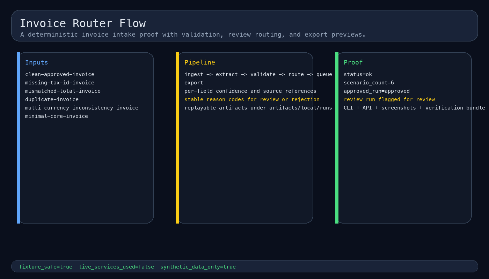
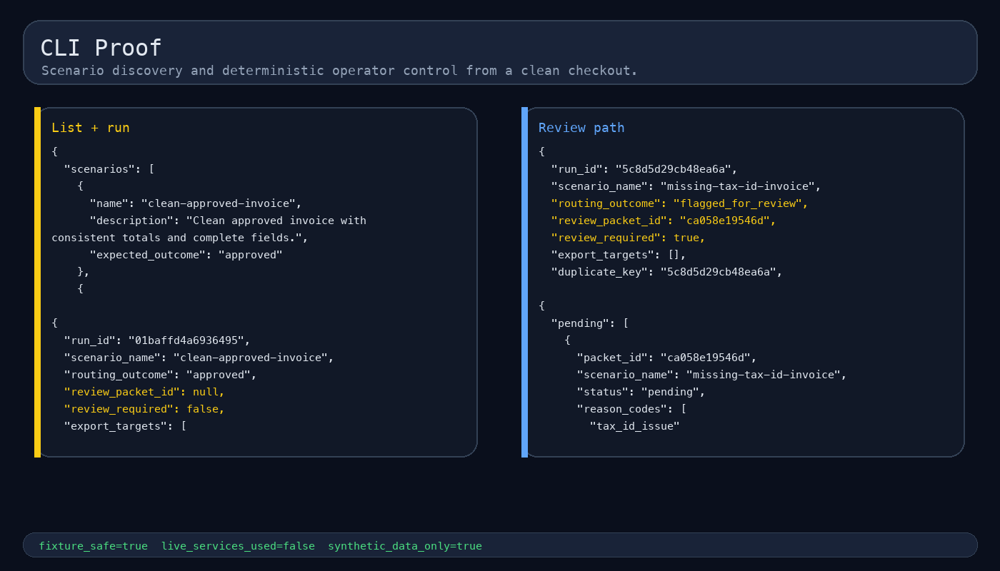
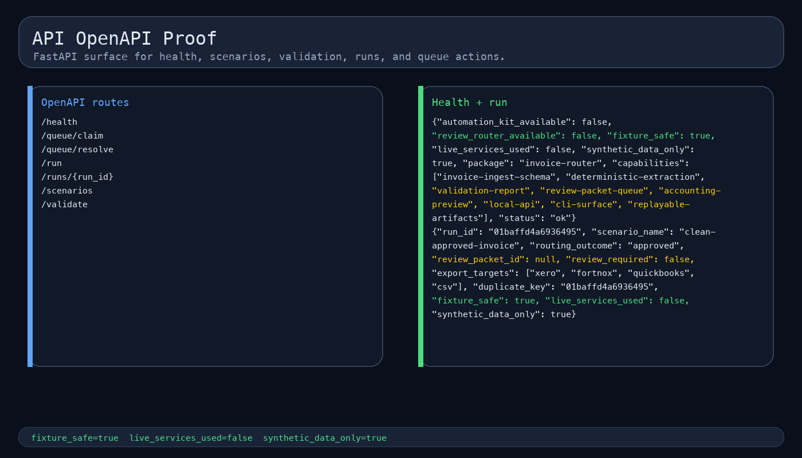
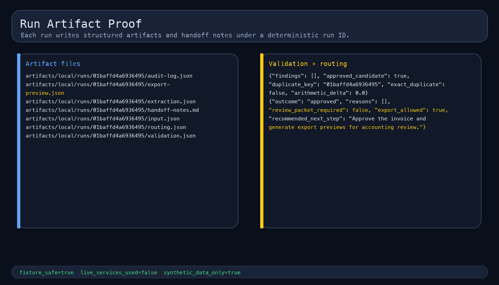
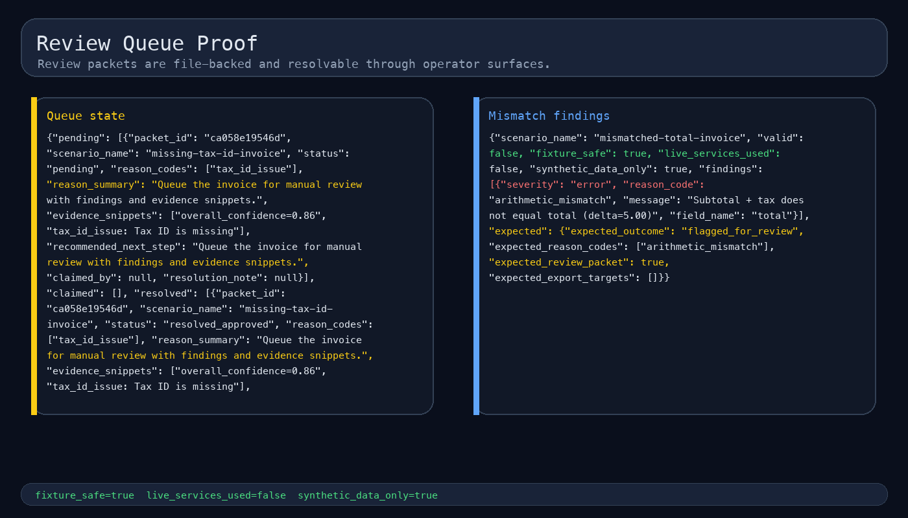
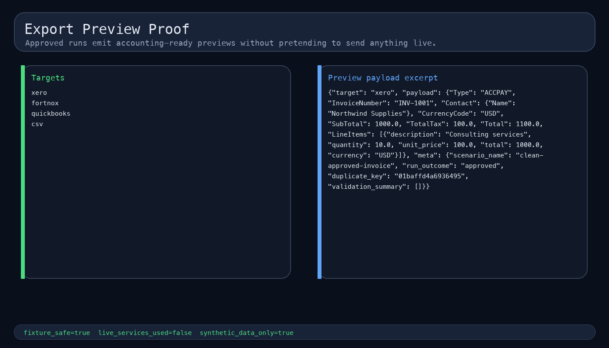
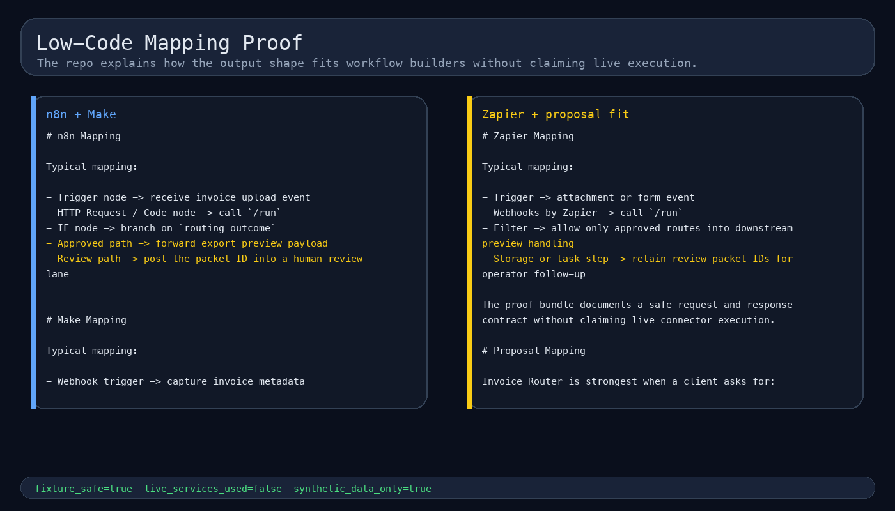
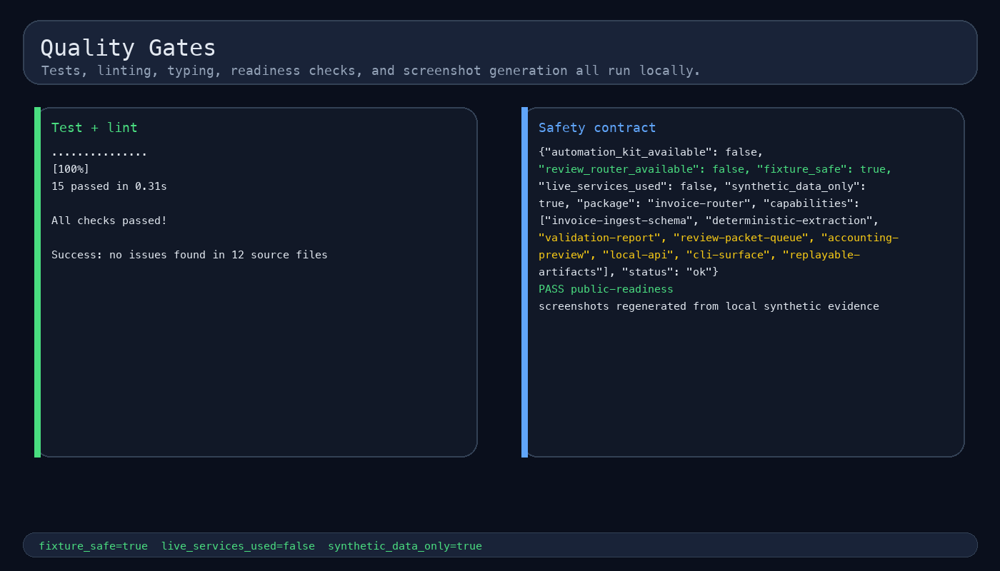

# Invoice Router

Fixture-safe invoice extraction, validation, review routing, and accounting export preview proof for document automation work.

Invoice Router proves one bounded workflow clearly: messy invoice-like documents can become structured, validated, auditable records with a deterministic review boundary before any live OCR, accounting credentials, or customer data enter the system.

## What this repository proves

- Typed contracts for ingest, extraction, validation findings, routing decisions, review packets, and export previews.
- Six synthetic invoice scenarios covering approval, review, and rejection paths.
- Deterministic extraction with per-field confidence, source references, and missing-reason handling.
- Validation checks for totals, dates, currencies, tax IDs, duplicates, and line-item completeness.
- File-backed review packets plus replayable per-run artifacts.
- Operator surfaces through both CLI and FastAPI.
- Xero-style, Fortnox-style, QuickBooks-style, and CSV export previews for approved cases.
- Public-safe proof only: synthetic fixtures, placeholder credentials, no external side effects.

## Safety boundary

Synthetic fixtures only. Empty credential placeholders only. No live OCR, live LLM calls, live accounting writes, customer data, email sends, public visibility changes, releases, cloud deployment, or external submissions are part of the default proof path.

## Quick start

```bash
python3.11 -m venv .venv
source .venv/bin/activate
pip install -e '.[dev]'
bash scripts/verify.sh
PYTHONPATH=src python3.11 -m invoice_router.cli list
PYTHONPATH=src python3.11 -m invoice_router.cli run clean-approved-invoice
```

## CLI surface

```bash
invoice-router list
invoice-router validate clean-approved-invoice
invoice-router run clean-approved-invoice
invoice-router replay <run_id>
invoice-router queue list
invoice-router queue claim <packet_id> --reviewer stefan
invoice-router queue resolve <packet_id> --reviewer stefan --decision approve --note "Approved after review"
invoice-router health --json
```

## Local API surface

```bash
PYTHONPATH=src python3.11 -m uvicorn invoice_router.api:app --host 127.0.0.1 --port 8024
curl -fsS http://127.0.0.1:8024/health
curl -fsS http://127.0.0.1:8024/scenarios
curl -fsS -X POST http://127.0.0.1:8024/run   -H 'Content-Type: application/json'   --data @examples/api-requests/run-clean-approved-invoice.json
```

## Evidence package

[](docs/screenshots/01-flow-overview.png)

[](docs/screenshots/02-cli-proof.png)

[](docs/screenshots/03-api-openapi.png)

[](docs/screenshots/04-run-artifact-proof.png)

[](docs/screenshots/05-review-queue-proof.png)

[](docs/screenshots/06-export-preview-proof.png)

[](docs/screenshots/07-low-code-mapping-proof.png)

[](docs/screenshots/08-quality-gates.png)

More evidence:

- `docs/architecture.md`
- `docs/api.md`
- `docs/case-study.md`
- `docs/evidence.md`
- `docs/sandbox-walkthrough.md`
- `docs/screenshots/README.md`

## How the review boundary works

1. Parse a synthetic invoice fixture into typed extracted fields.
2. Record confidence and source references for every required field.
3. Validate arithmetic, currency, dates, tax IDs, duplicates, and line items.
4. Approve clean high-confidence cases.
5. Write a file-backed review packet when policy requires operator attention.
6. Emit export previews only when the route outcome remains approved.

## Related repositories

- `automation-kit` — reusable local automation patterns and optional shared conventions.
- `review-router` — stronger reference for file-backed review queue discipline.
- `sheets-airtable-sync` — reference for typed output normalization and export proof surfaces.

These references inform shape and conventions only. Invoice Router stands on its own and ships as a self-contained proof repo.

## Project docs

| Path | Purpose |
|---|---|
| `docs/architecture.md` | package boundaries, runtime flow, artifact layout, and review discipline |
| `docs/api.md` | FastAPI endpoints and request/response examples |
| `docs/case-study.md` | buyer-facing workflow framing and scenario outcomes |
| `docs/evidence.md` | reproducible verification commands and proof notes |
| `docs/sandbox-walkthrough.md` | end-to-end local walkthrough |
| `docs/public-readiness-checklist.md` | public-surface checklist |
| `docs/automation-kit-backbone.md` | optional shared-convention and capability boundary |
| `docs/low-code/` | n8n, Make, and Zapier mapping notes |
| `docs/proposal-mapping.md` | capability-to-keyword fit and positioning |
| `docs/live-integration-gate.md` | what would be needed for future live proof |

## Quality gates

```bash
bash scripts/verify.sh
PYTHONPATH=src python3.11 scripts/public_readiness_check.py
PYTHONPATH=src python3.11 scripts/generate_screenshots.py
```

## Environment

| Variable | Purpose |
|---|---|
| `INVOICE_ROUTER_ENABLE_LIVE_SERVICES` | stays `false` for fixture-safe mode |
| `INVOICE_ROUTER_API_HOST` | local API host |
| `INVOICE_ROUTER_API_PORT` | local API port |
| `INVOICE_ROUTER_RUN_DIR` | local run artifact path |
| `INVOICE_ROUTER_QUEUE_DIR` | local queue path |
| `XERO_API_TOKEN` | placeholder only |
| `FORTNOX_ACCESS_TOKEN` | placeholder only |
| `QUICKBOOKS_ACCESS_TOKEN` | placeholder only |
| `OCR_PROVIDER_KEY` | placeholder only |
| `LLM_PROVIDER_KEY` | placeholder only |

## Repository layout

```text
src/invoice_router/        package modules
fixtures/                  synthetic input, expected outputs, and notes
examples/                  API request and response examples
docs/                      architecture, API, evidence, mappings, screenshots
scripts/                   verification and screenshot generation
tests/                     unit and integration tests
artifacts/                 gitignored queue and run outputs created at runtime
registry/                  capability metadata and scenario registry
```

## License

MIT License. See LICENSE.
